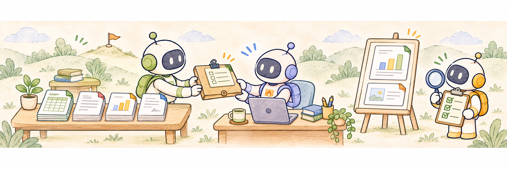
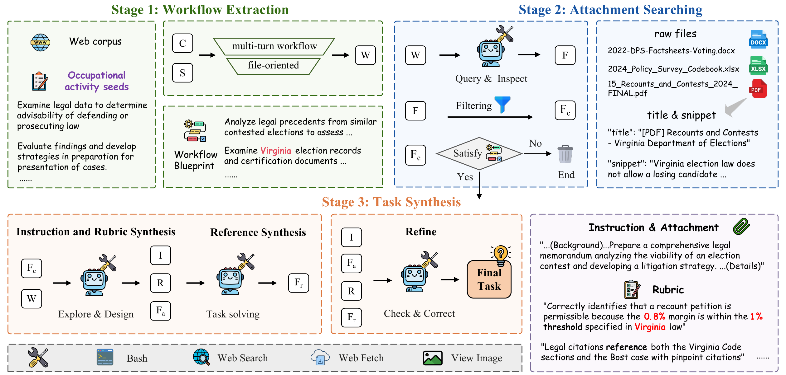
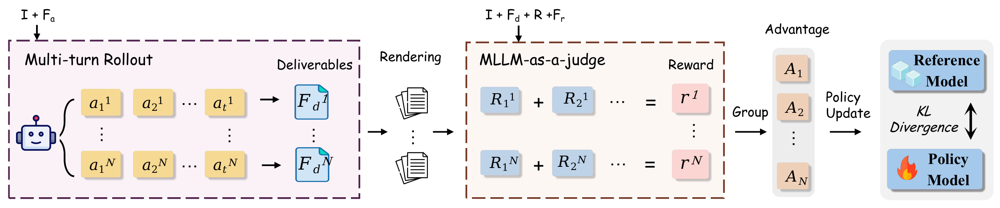

<div align="center">

<h1>
  <picture>
    <source media="(prefers-color-scheme: dark)" srcset="assets/title-dark.png">
    
  </picture>
</h1>

### Scaling Agents for Realistic Productivity Work via Real-Source Data Synthesis

</div>

<p align="center">
Teng Pan<sup>1,2</sup>, &nbsp;
Zixuan Wang<sup>1,2</sup>, &nbsp;
Yuchen Yan<sup>1</sup>, &nbsp;
Qifei Wu<sup>2</sup>, &nbsp;
Yao Chen<sup>2</sup>, &nbsp;
Yingqi Qu<sup>2</sup>, &nbsp;
Ruiqing Zhang<sup>2</sup>,<br>
Yongliang Shen<sup>1,†</sup>
</p>

<p align="center">
<sup>1</sup>Zhejiang University, &nbsp; <sup>2</sup>Baidu Inc.<br>
Preprint.<br>
<sup>†</sup>Corresponding Author
</p>

<p align="center">
  <a href="https://arxiv.org/abs/2611.08219"></a>
  <a href="https://zjureal.com/Agent-R2/"></a>
  <a href="https://huggingface.co/teng-pan/Agent-R2-4B"></a>
</p>

<p align="center">
  
</p>

<p align="center">
  <a href="#overview">Overview</a> ·
  <a href="#news">News</a> ·
  <a href="#results">Results</a> ·
  <a href="#data-synthesis">Data Synthesis</a> ·
  <a href="#rl">RL</a> ·
  <a href="#evaluation">Evaluation</a> ·
  <a href="#citation">Citation</a>
</p>

<a id="overview"></a>

## 🔎 Overview

Current LLM agents still struggle with realistic productivity work, which requires following long-horizon professional workflows, understanding heterogeneous files, and producing usable deliverables, largely because scalable post-training data that reflects real work is lacking. We introduce Agent-R<sup>2</sup>, a **r**eal-source data synthesis framework for **r**ealistic productivity work. Instead of manually specified workflows or LLM-generated files, Agent-R<sup>2</sup> grounds synthesis in real occupational seeds, corpus-derived workflow evidence, and authentic web-sourced files, distilling 4k task instances with real multi-format attachments and deliverable-level rubrics from 10k web-corpus candidates. Trained on this data with SFT and rubric-based RL, Agent-R<sup>2</sup>-4B surpasses Qwen3-235B-A22B-Thinking-2507 on GDPval (51.0% vs. 48.0%) and OfficeQA (14.8% vs. 13.8%), and mitigates *shortcut behavior* while promoting sustained exploration.

### Data synthesis pipeline



### RL training framework



<a id="news"></a>

## 📰 News

- **Nov 2026** — Project page released: <https://zjureal.com/Agent-R2/>.
- **Nov 2026** — Paper released on [arXiv](https://arxiv.org/abs/2611.08219); model [Agent-R2-4B](https://huggingface.co/teng-pan/Agent-R2-4B) on Hugging Face.

<a id="results"></a>

## 📊 Main Results on GDPval

| Model | Office Pass@1 | Office Pass@3 | Non-Office Pass@1 | Non-Office Pass@3 | Full Pass@1 | Full Pass@3 |
|---|:---:|:---:|:---:|:---:|:---:|:---:|
| ***Closed-Source Models*** | | | | | | |
| GPT-4.1 | 38.0 | 51.5 | 44.9 | 55.5 | 39.4 | 52.3 |
| Gemini-2.5-Pro | 57.0 | 59.4 | 61.4 | 63.3 | 57.9 | 60.2 |
| Claude-Opus-4.5 | 73.8 | 77.4 | 68.2 | 72.3 | 72.6 | 76.3 |
| ***Open-Source Models*** | | | | | | |
| DeepSeek-v3.1 | 48.3 | 57.5 | 50.9 | 61.7 | 48.8 | 58.4 |
| GLM-4.7 | 60.8 | 67.1 | 61.9 | 68.3 | 61.1 | 67.4 |
| Qwen3-30B-A3B-Thinking-2507 | 33.7 | 38.5 | 40.4 | 44.9 | 35.0 | 39.8 |
| Qwen3-235B-A22B-Thinking-2507 | 46.9 | 52.9 | 52.0 | 58.6 | 48.0 | 54.1 |
| Qwen3-VL-235B-A22B-Thinking | 48.4 | 50.9 | 54.7 | 57.9 | 49.7 | 52.4 |
| ***Agent-R<sup>2</sup> (Ours)*** | | | | | | |
| Qwen3-4B-Thinking-2507 | 31.1 | 35.7 | 37.8 | 42.3 | 32.4 | 37.0 |
| Agent-R<sup>2</sup>-4B-SFT | 45.9 | 51.5 | 42.8 | 47.6 | 45.3 | 50.7 |
| **Agent-R<sup>2</sup>-4B** | **51.5** | **54.7** | **48.9** | **55.1** | **51.0** | **54.8** |

Pass@k allows up to k attempts and scores the first attempt that produces a deliverable; results are reported for office, non-office and full subsets.

<a id="repository-layout"></a>

## 🗂️ Repository Structure

```
Agent-R2/
├── Agent-R2/
│   ├── settings/             # settings.yaml: the only place to fill URLs / keys / proxy
│   ├── llm/                  # model callers: OpenAI-compatible, claude, gemini, vllm
│   ├── tools/                # terminal, web_search, web_fetch, view_image_* tools
│   ├── data_sythesis/        # data synthesis
│   ├── gdpval/               # GDPval evaluation
│   ├── officeqa/             # OfficeQA evaluation
│   └── sythesis_test/        # held-out synthesized test
├── ms-swift/
│   └── run_qwen3.sh          # SFT launch script
└── verl/
    └── recipe/agent_r2/      # Agent-R2 multi-turn GRPO recipe
```

<a id="preparation"></a>

## 🛠️ Preparation

### APIs and keys

All URLs, keys and the proxy are set **once** in `Agent-R2/settings/settings.yaml`; data synthesis, SFT data export, RL and evaluation all read this file.

| Key | Used by |
|---|---|
| `llm_api_url`, `llm_api_key` | OpenAI-compatible LLM gateway: synthesis agents, vision tool, evaluation LLM judges, API-model solvers |
| `reward_judge_api_url`, `reward_judge_api_key` | RL reward judge (e.g. a separately served vLLM model). If left empty, `llm_api_url` and `llm_api_key` are used. |
| `serper_api_key` | `web_search*` (`google.serper.dev`) and `web_fetch` (`scrape.serper.dev`) |
| `proxy` | HTTP proxy used when no `https_proxy`/`http_proxy` env var is set. If left empty, no proxy is used. |

Model choices stay in each module's `config.yaml` (`family` / `model_id` of the synthesis agents, solver, evaluator and vision model).

### Sandbox

Agents run code inside isolated sandbox sessions, one session per trajectory. Our experiments use Baidu's internal sandbox infrastructure, whose service key is read from `sandbox_api_key` in `settings.yaml`. [AIO Sandbox](https://github.com/agent-infra/sandbox) can be used as an alternative sandbox implementation.

<a id="data-synthesis"></a>

## 🧪 Data Synthesis

Seed data lives in `Agent-R2/data_sythesis/seed_task/`. These files are included:

- `Task Statements.xlsx`: occupational activity seeds, columns `Title`, `Task`
- `discipline_to_title.json`: `{discipline: Title}` for the disciplines used in synthesis
- `disciplines.json`, `title_categories.json`: full discipline and occupation lists

Download the web-corpus data for `sample.jsonl` from [Attention1115/DLR-Web](https://huggingface.co/datasets/Attention1115/DLR-Web):

```bash
cd Agent-R2/data_sythesis/seed_task
pip install datasets
python download.py    # → sampled_200perclass.json
```

After preparing the data, run:

```bash
cd Agent-R2/data_sythesis
python run.py                       # scenario → search → question → solver → refine
python prepare_sft_data_split.py    # → data/sft.jsonl
python prepare_rl_data.py           # → rl_data/data{N}.zip
```

Each sample is written to `output/sample_{idx}/` (scenario, searched attachments, instruction + rubric, solver trajectory). Which agents run is controlled by `agent_run.*` in `config.yaml`; each step is skipped if its result file already exists, so reruns resume.

<a id="sft"></a>

## 🏋️ SFT

`prepare_sft_data_split.py` writes one sample per assistant turn in ms-swift format: `{"tools": "<json string>", "messages": [...]}` with roles `system/user/assistant/tool_response`; only the last turn has `loss: true`. `run_qwen3.sh` reads it from `Agent-R2/data_sythesis/data/sft.jsonl`:

```bash
cd ms-swift && MODEL_PATH=/path/to/Qwen3-4B-Thinking-2507 bash run_qwen3.sh   # 8 GPUs, full-param, seq-parallel 2, max_length 60000
```

The checkpoint is written to `ms-swift/output/`.

<a id="rl"></a>

## 🎯 RL

1. Put your `train.parquet` / `test.parquet` in the empty placeholder `Agent-R2/data_sythesis/output/` (keep the `output/sample_*` tree next to them). One row per task:

   - `prompt`: list of chat messages (system + user)
   - `data_source`: str (default `real`)
   - `extra_info`: `task_id`, `question` (title / description / attachments), `rubric` (list of `{criterion, points, category, source}`), `input_dir` (input attachments, uploaded to the sandbox), `sample_dir`

   Then build the training parquet (adds per-task tool kwargs), written to `verl/recipe/agent_r2/data/train.parquet`:

   ```bash
   cd verl
   python recipe/agent_r2/preprocess.py
   ```

2. Train from the SFT checkpoint:

   ```bash
   cd verl
   MODEL_PATH=/path/to/sft_checkpoint bash recipe/agent_r2/run_agent_r2.sh
   ```

   The reward is computed by an MLLM judge (`reward_config` in `recipe/agent_r2/config/ppo_trainer_real.yaml`) scoring the rendered deliverables against the rubric.

<a id="evaluation"></a>

## 📏 Evaluation

| Benchmark | Data placeholder | Contents |
|---|---|---|
| GDPval | `Agent-R2/gdpval/{data,reference_files,deliverable_files}/` | from [openai/gdpval](https://huggingface.co/datasets/openai/gdpval); `data/train-00000-of-00001.json` as a JSON **list** |
| OfficeQA | `Agent-R2/officeqa/data/` | from [databricks/officeqa](https://huggingface.co/datasets/databricks/officeqa); `officeqa_full.csv` and `treasury_bulletins_parsed/transformed/*.txt` |

After serving the model, run from the inner `Agent-R2/` directory:

```bash
cd Agent-R2
python gdpval/run.py
python officeqa/run.py
```

Results go to `<module>/results/<solver.model_id>/<task_id>/` and `summary.json`; finished tasks are skipped on rerun.

<a id="citation"></a>

## 📝 Citation

If you find Agent-R2 useful, please cite:

```bibtex
@article{pan2026agentr2,
  title   = {Agent-R$^2$: Scaling Agents for Realistic Productivity Work via Real-Source Data Synthesis},
  author  = {Pan, Teng and Wang, Zixuan and Yan, Yuchen and Wu, Qifei and Chen, Yao and Qu, Yingqi and Zhang, Ruiqing and Shen, Yongliang},
  journal = {arXiv preprint arXiv:2611.08219},
  year    = {2026}
}
```

<a id="acknowledgement"></a>

## 🙏 Acknowledgement

This project is trained with [ms-swift](https://github.com/modelscope/ms-swift) and [verl](https://github.com/volcengine/verl). Part of the data we use comes from [DESIGNER](https://arxiv.org/abs/2508.12726).
